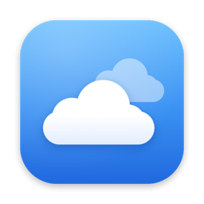
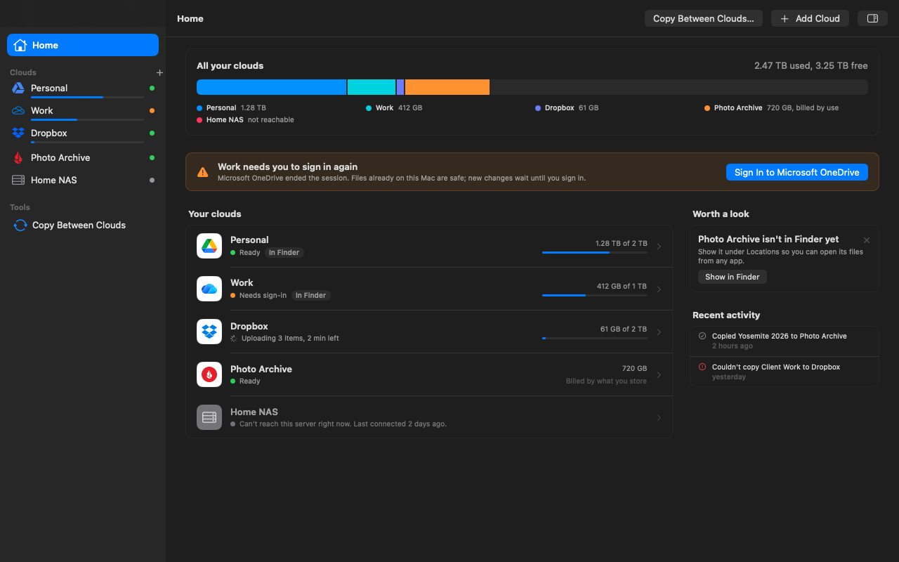

<p align="center">
  
</p>

<h1 align="center">Nimbus</h1>

<p align="center">
  A native macOS app for cloud storage: browse, mount and sync 50+ providers through rclone, with Finder integration.
</p>

<p align="center">
  Free and open source, from the studio behind <a href="https://beltr.app/?utm_source=github&utm_medium=readme&utm_campaign=nimbus">Beltr</a> and <a href="https://apps.apple.com/us/app/onescribe-ai-note-scanner/id6756506734">OneScribe</a>.
</p>

<p align="center">
  <a href="https://github.com/CasaVargas/Nimbus/actions/workflows/ci.yml"></a>
  
  
</p>

<p align="center">
  
</p>

## Why

**It is a real Mac app.** Nimbus is SwiftUI and AppKit, Swift 6, macOS 15 and up. There is no Electron, no web view, no cross-platform toolkit. Selection, drag and drop, Quick Look, keyboard shortcuts and column sorting behave the way they do in Finder, because the design target is "indistinguishable from Finder at a glance".

**It does not reimplement cloud providers.** Nimbus spawns [rclone](https://rclone.org) as a local daemon and talks to its RC API over loopback. Every backend rclone supports (S3 and compatibles, Google Drive, OneDrive, Dropbox, Backblaze B2, SFTP, WebDAV, crypt, and dozens more) works in Nimbus, with rclone's own config format, so you can keep using the `rclone` command line alongside the app.

**It integrates with the system instead of replacing it.** Remotes show up in Finder's sidebar through a File Provider extension, or as NFS volumes if you prefer a classic mount. There is no account, no sign-in, no telemetry and no update pinging. rclone does all the cloud traffic; Nimbus itself only goes online if you ask it to download rclone for you (from rclone.org, checked against rclone's published checksums).

## Install

Download the latest signed and notarized DMG from the [Releases](https://github.com/CasaVargas/Nimbus/releases/latest) page (`Nimbus-<version>.dmg`, with a `.sha256` beside it), open it, and drag Nimbus to Applications. Nimbus is pre-1.0; expect rough edges. You can also build from source (below).

### Requirements

- macOS 15 (Sequoia) or later, Apple Silicon or Intel
- rclone: Nimbus uses your Homebrew rclone (`brew install rclone`) if you have one, or offers to download the official build on first launch (the path is configurable in Settings > Advanced)

### Build from source

You need Xcode 27 or later (earlier Xcode releases crash in IRGen while compiling this project), XcodeGen and rclone.

```bash
brew install xcodegen rclone
git clone https://github.com/CasaVargas/Nimbus.git
cd Nimbus

# Optional: your Apple Developer team for a signed build (needed for Finder integration).
cp Nimbus/Local.xcconfig.example Nimbus/Local.xcconfig   # then set DEVELOPMENT_TEAM

cd Nimbus && xcodegen generate && cd ..
git checkout -- Nimbus/FileProviderExtension/Info.plist   # xcodegen rewrites it; keep the committed one

# Either open Nimbus/Nimbus.xcodeproj in Xcode, or build from the CLI:
xcodebuild -project Nimbus/Nimbus.xcodeproj -scheme Nimbus -destination 'platform=macOS' build \
  CODE_SIGNING_ALLOWED=NO CODE_SIGNING_REQUIRED=NO     # drop these two if you set a team
```

Release packaging:

```bash
bash scripts/build-release.sh      # Release .app in Nimbus/build/Build/Products/Release/
bash scripts/package-release.sh    # dist/Nimbus-<version>.dmg (+ .sha256)

# Signed and notarized DMG (maintainer release):
NIMBUS_SIGN_IDENTITY="Developer ID Application: ..." \
NIMBUS_NOTARY_PROFILE="<notarytool keychain profile>" \
bash scripts/package-release.sh
```

See [CONTRIBUTING.md](CONTRIBUTING.md) for running the tests.

## How it works

```
SwiftUI app (Nimbus/Nimbus/) ──▶ RcloneKit ──HTTP──▶ rclone rcd (127.0.0.1) ──▶ Cloud providers
                                     ▲
                                     │
File Provider extension (Nimbus/FileProviderExtension/) ──────────────▶ Finder
```

| Layer | What it is |
|-------|------------|
| App | SwiftUI, Swift 6 strict concurrency, `@Observable` view models, AppKit where SwiftUI falls short (the file table) |
| RcloneKit | Local Swift package: a typed HTTP client for rclone's RC API, used by both the app and the extension |
| File Provider extension | `NSFileProviderReplicatedExtension` that enumerates remotes into Finder; shares the daemon port with the app through an app group |
| NFS mounts | `rclone serve nfs` plus `mount_nfs`, managed in-process; survives app restarts and cleans up on quit |
| rclone | Your installed binary, started as `rclone rcd` on loopback. Nimbus never bundles or patches it; it can download the official build for you |

No third-party Swift packages. A pre-build lint fails the build if one is added.

## Status

Pre-1.0. The app is used daily by its author; expect rough edges and breaking changes before 1.0.

Works today:

- Browser with list and icon views, Finder-style multi-select, column sorting, type-to-select, Quick Look, drag and drop within and across remotes
- Guided Add Remote driven by rclone's own config state machine, so new backends need no app changes
- Finder integration through the File Provider extension (requires a signed build): files download on demand, Keep Downloaded pins them, photos and PDFs get thumbnails before they are downloaded, and changes made elsewhere show up within about ten minutes
- Copy Share Link in Finder and the inspector, with expiry and Stop Sharing where the service supports them (rclone 1.76 or later)
- Backups on a schedule, from a folder or a cloud to another cloud or folder, with a preview before the first run, exclude lists, a versions folder for replaced and removed files, and a removal limit
- Home: free space across all your clouds and each cloud's status in plain words
- NFS mounts with auto-mount and restore on launch
- Copy and sync between any two remotes or local folders, with a transfer queue, history, bandwidth limit and notifications
- Menu bar panel, launch at login, Settings window modeled on System Settings
- Diagnostics: copy a sanitized system report, open the app's logs in Console

Not done yet (tracked in [issues](https://github.com/CasaVargas/Nimbus/issues); how Nimbus compares feature by feature is in the [parity report](docs/superpowers/reports/2026-11-11-feature-parity.md)):

- Search, in the app and in Spotlight
- An encrypted-folder setup flow, and sign-ins kept in the Keychain (today they are in `rclone.conf`, as rclone writes them)
- Shortcuts, Services menu, Share Sheet
- Backups that run while Nimbus is closed
- Media gallery and other advanced browser modes

Design specs and per-phase exit gates live in [`docs/superpowers/specs/`](docs/superpowers/specs/).

## How it compares

Facts only, checked against vendor pages on 2026-11-11; "unverified" means we did not confirm it. Corrections welcome. The full comparison, against 15 apps, is in the [parity report](docs/superpowers/reports/2026-11-11-feature-parity.md).

| | Nimbus | Mountain Duck | ExpanDrive | Cyberduck | rclone |
|---|---|---|---|---|---|
| Price model | Free, source and signed builds alike | One-time license per major version; subscription on the Mac App Store | Free for personal use; subscription for business | Free (donations; paid on the Mac App Store) | Free |
| Open source | Yes, GPL-3.0-or-later | No | No | Yes, GPL-3.0 | Yes, MIT |
| UI | Native SwiftUI/AppKit | Native Cocoa over a Java core (unverified) | Unverified | Native Cocoa over a Java core (unverified) | Command line, plus `rclone gui` in a browser tab |
| Finder / mount | File Provider and NFS | File Provider and NFS | File Provider | No mounting; transfer client | FUSE (macFUSE) or NFS via `rclone mount` / `serve nfs` |
| Providers | Everything rclone supports (50+) | 19 protocols | 15 | About 15 protocols | 50+ |
| Reuses your rclone config | Yes | No | No | No | n/a |
| Scheduled backups with a preview | Yes | No | No | No (sync preview, no schedule) | With your own cron and `--dry-run` |

## Support development

Nimbus costs nothing: not the source, not the signed app, and that will not change. It is built by [Casa Vargas](https://casavargas.app), which pays for the time with two apps, each bought once and kept. If Nimbus is useful to you, the best way to say thanks is to try one of them:

- **[Beltr](https://beltr.app/?utm_source=github&utm_medium=readme&utm_campaign=nimbus)**: karaoke from the music you already own, on your TV, with every phone in the room as a mic and remote. Mac, Windows and Linux. $19.99 once, five songs free to try.
- **[OneScribe](https://apps.apple.com/us/app/onescribe-ai-note-scanner/id6756506734)**: a document scanner for iPhone and iPad that reads what it scans, with the AI running on the device. Free to scan; Pro is $9.99 once.

Stars, bug reports and pull requests are welcome too.

## Contributing

Issues and pull requests are welcome. Read [CONTRIBUTING.md](CONTRIBUTING.md) for the build setup, test commands and the spec-first workflow, and [SECURITY.md](SECURITY.md) for how to report vulnerabilities privately. Participation is covered by the [Code of Conduct](CODE_OF_CONDUCT.md).

## License

Nimbus is licensed under the GNU General Public License, version 3 or later (`SPDX-License-Identifier: GPL-3.0-or-later`). See [LICENSE](LICENSE). Copyright Casa Vargas LLC.

Nimbus is free, source and signed builds alike. Development is paid for by Casa Vargas's other apps; see [Support development](#support-development).

### Legacy

The original Tauri (Rust + React) build is end-of-life. Its sources are preserved at `legacy/tauri/` for reference, and the last working Tauri state is frozen on the [`tauri-eol`](https://github.com/CasaVargas/Nimbus/tree/tauri-eol) branch. See [`DEPRECATED.md`](DEPRECATED.md).
